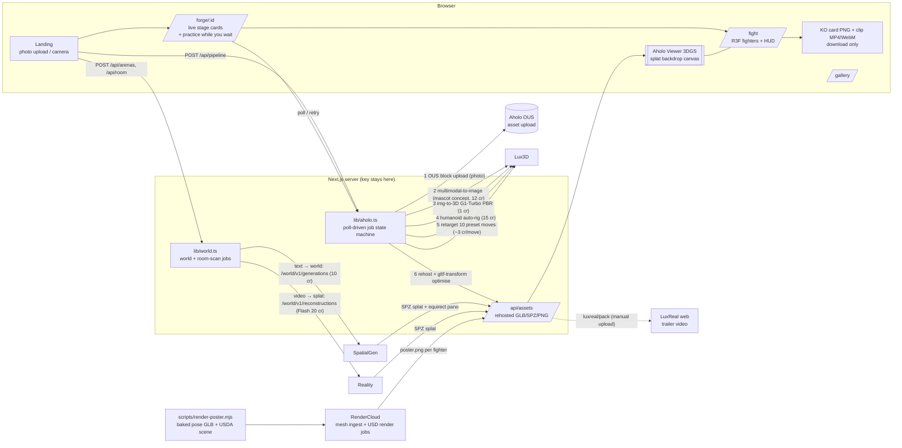

> **Handoff for another agent:** see [`HANDOFF.md`](./HANDOFF.md) — full project context, architecture, API cheat-sheet, status, and next steps.

# Anything Fighter 🥊: Aholo 3D AI Hackathon entry

> Snap anything. Fight everything. One photo of a mug, a sneaker or a rubber duck becomes a rigged, animated 3D fighter
> (Aholo Lux3D), brawls in an AI-generated 3D world (Aholo SpatialGen / your own room via Aholo Reality), and gets a
> cinematic KO poster (Aholo RenderCloud).

Next.js 16 (App Router, TS, Tailwind 4) · React Three Fiber + drei · Zustand · **Manycore Aholo official TypeScript SDKs** (Lux3D, World = SpatialGen + Reality, Asset upload) · RenderCloud OpenAPI · Aholo Viewer (3DGS) · LuxReal (manual trailer pack).

## Manycore stack (official SDKs at the core)

Following Manycore's guidance (`llms.txt`: *app integration code → SDK, do not hand-write HTTP*), every Aholo call the app
makes goes through the official packages, created once in [`lib/aholo-sdk.ts`](./lib/aholo-sdk.ts) (server-only, key from
`AHOLO_API_KEY`, global region `com` → `https://api.aholo.ai`):

| Package | Used for | Calls |
|---|---|---|
| [`@manycore/aholo-sdk-asset`](https://labs.aholo.ai/api-docs/en/sdk/typescript) | Photo, room-scan and GLB uploads (SDK handles single/multipart OUS) | `uploadBuffer` |
| `@manycore/aholo-sdk-lux3d` | The whole fighter forge | `multimodalToImage.create`, `imgTo3d.create`, `humanoidAutoRig.create`, `humanoidAnimationRetarget.create`, `multiFormatExport.create` (printable STL/3MF/USDZ), `tasks.retrieve` |
| `@manycore/aholo-sdk-world` | SpatialGen arenas, Aholo Reality room scans, queue guard | `generations.create`, `reconstructions.create`, `retrieve`, `list` |
| `@manycore/aholo-sdk-core` | Error types (`AuthenticationError`, `RateLimitError`, `BusinessError`) and the authenticated gateway transport for **RenderCloud**, which has no SDK and stays on its OpenAPI routes | `createGatewayClient().gatewayRequest` |
| `@manycore/aholo-viewer` | 3DGS arenas rendered under the R3F canvas | `components/arena/AholoSplatLayer.tsx` |

Design rules kept from the REST version: the key never leaves the server; no key → **mock mode**; the per-IP/global
**spend guard** (`lib/forge-limit.ts`); and the **poll-driven state machine**: each request does one SDK `create` or one
`tasks.retrieve` / `world.retrieve`, never a long blocking `waitFor` inside a serverless function. SDK errors are mapped to
app errors (429 / 5xx / network = transient, retried on the next poll). The in-app **"Powered by Aholo"** strip on the forge
page and every gallery card lists the services that actually built that fighter. (The one-off scripts in `scripts/` predate
the SDK migration and still call the REST API directly; they are not part of the deployed app.)

## Architecture — every Aholo tool and how it is used



| Aholo tool | Endpoint(s) | Used for | Code |
|---|---|---|---|
| OUS asset upload | `/ous/api/v2/upload/token`, `block/upload/init|part`, `upload/status` | Uploading the user photo, room-scan video and GLBs (multipart > 1 MB, dedup aware) | `lib/aholo-sdk.ts uploadAsset` (aholo-sdk-asset) |
| Lux3D multimodal image | `/global/lux3d/v1/multimodal-to-image` | Turns any object photo into a full-body humanoid "mascot" concept (so it can be rigged) | `lib/aholo.ts` via aholo-sdk-lux3d |
| Lux3D image → 3D | `/global/lux3d/v1/img-to-3d` (G1-Turbo, PBR) | Concept → textured mesh | same |
| Lux3D auto-rig | humanoid rig task | Mixamo-named 52-joint skeleton | same |
| Lux3D retarget | retarget task, 10 presets | idle, walk, jab, cross, hook (kick), block, hit ×2, KO, victory dance | `lib/moves.ts` |
| SpatialGen | `/global/world/v1/generations`, `/global/world/v1/{id}` | Text → 3D Gaussian-splat arenas + panoramas (kitchen colosseum, toy shop, rooftop dojo) | `lib/world.ts` via aholo-sdk-world, `POST /api/arenas` |
| Reality | `/global/world/v1/reconstructions` | "Fight in your room": phone video → splat arena | `lib/world.ts` via aholo-sdk-world, `components/landing/RoomScan.tsx`, `POST /api/room` |
| Aholo Viewer | `@manycore/aholo-viewer` (vendored to `public/vendor`) | Renders SPZ/PLY/SOG splats under the transparent R3F canvas, camera synced every frame | `components/arena/AholoSplatLayer.tsx` |
| RenderCloud | `/global/rendercloud/v1/mesh-upload-process/task/*`, `/global/rendercloud/v1/jobs` | Path-traced KO/victory posters from a USD scene (baked pose + studio backdrop + lights) | `lib/poster.ts` (OpenAPI via aholo-sdk-core gateway), `lib/poster-usda.ts` |
| LuxReal | web app only (no API) | Optional cinematic trailer from the posed GLBs + panoramas | `luxreal/README.md`, `scripts/luxreal-pack.mjs` |

## Run

```bash
npm install
# API key: generated from the box secret, gitignored. Never commit it or print it.
printf 'AHOLO_API_KEY=%s\n' "$(tr -d '\n\r ' < /home/box/.secrets/aholo_api_key)" > .env.local
npm run dev            # http://localhost:3000  (predev copies the Aholo Viewer into public/vendor)
npm run build && PORT=3100 npm start
npm run lint
npm run screens        # Playwright screenshots → screens/ (expects the server on :3100)
set -a; . ./.env.local; set +a
node scripts/forge-fighter.mjs all                 # starter roster (credits! ~60/fighter, resumable)
node scripts/gen-worlds.mjs [arena-id]             # SpatialGen arenas (10 cr each, resumable)
node scripts/reconstruct-room.mjs public/arenas/my-room/scan.mp4 my-room   # Reality room scan (20 cr)
node --env-file=.env.local scripts/render-poster.mjs mug               # RenderCloud poster
node scripts/e2e-forge.mjs photo.jpg "Name"       # live UI end-to-end via Playwright (credits!)
```

If `AHOLO_API_KEY` is not set, every pipeline (fighters, worlds, room scans) switches to **mock mode** with clearly labelled
simulated stages, so the UI can be demoed offline.

### Vercel preview

The app is built to run on Vercel Functions. `GET /api/pipeline/[id]` advances the Lux3D job by one step
(no long-lived background process). `maxDuration` is set to 300s on pipeline routes (Hobby plans may cap
this at 60s; retarget downloads are therefore processed one clip per poll).

Job state and newly forged files are stored in the **Vercel Runtime Cache** (free, per-region, ephemeral,
2 MB items chunked) plus `/tmp`. The starter roster (and a few baked user forges in `public/fighters/gen-*`)
ship with the deployment and are durable. When a **Vercel Blob** store is connected (`BLOB_READ_WRITE_TOKEN`,
private store; free on Hobby within its limits) every finished live fighter is also saved as one Blob pack
(`lib/durable.ts`, 2 Blob operations per forge) and read back after the cache evicts it. Without Blob,
generated fighters can be evicted; the roster then hides any fighter whose model file is gone, and the fight
scene swaps a missing model/clip for procedural moves or the Boltbox stand-in instead of crashing.

Live forges are capped to protect Aholo credits:

| Env var | Default | Meaning |
|---|---|---|
| `FORGE_IP_DAILY_LIMIT` | 2 | Live forges per client IP per Africa/Lagos day |
| `FORGE_GLOBAL_DAILY_LIMIT` | 15 | Live forges across all IPs per day |
| `FORGE_LIMIT_FALLBACK` | `mock` | `mock` continues as a clearly labelled demo forge (no credits, stand-in robot body) so nobody hits a dead end; `block` returns HTTP 429 "Forge limit reached, try the roster" |

Counters use Runtime Cache on Vercel, or an in-memory map (per instance, resets on cold start) when the
cache API is unavailable. Limits do not apply in mock mode.

## Play

| | Player 1 | Player 2 (2-player mode) |
|---|---|---|
| Move | A / D (solo: also ← →) | ← / → |
| Jump | W (solo: also ↑ / Space) | ↑ |
| Crouch (hold) | S (solo: also ↓) | ↓ |
| Punch | J (2P: F) | K / Numpad 1 |
| Kick (heavy) | K (2P: G) | L / Numpad 2 |
| Block (hold; with crouch = crouch-block) | L / Shift / C (2P: H) | M / Numpad 0 |
| Special | U / V, or back→forward + punch (2P: R) | O / Numpad 3 |
| Super (meter full) | I / B (2P: T) | P / Numpad 6 |

Moves: **P P K** (jab → cross → hook, knockdown) and **K P** strings cancel on hit; **crouch + P** low punch, **crouch + K**
sweep (knockdown; lows must be crouch-blocked), **P or K in the air** = jump attack (overhead: block it standing).
Jabs and crosses whiff over a crouch; most ground attacks miss a jumping fighter, but a clean hit on anyone airborne is
an **anti-air knockdown** (kick and hook reach highest). Tap block just before a hit to **parry**.

Touch devices get an on-screen pad (▲ Jump, ▼ Crouch, ◀ ▶, Punch, Kick, Block, Special, Super with the meter ring). Modes: **1P vs CPU**, **2 players on one keyboard** (landing toggle or `&mode=2p`),
**practice** (sparring partner, infinite time — shown while your fighter is forging). The 🔊 button toggles sound.
After a fight: rematch, **KO card** (1600×900 PNG with the RenderCloud poster) and a **clip** of the fight
(MediaRecorder canvas capture → MP4 where supported, else WebM) to download and share manually. Nothing is posted automatically.

## Layout

| Path | What |
|---|---|
| `app/page.tsx` → `components/landing/Landing.tsx` | Mobile-first arcade home: forge panel (snap/upload, "Powered by Aholo" strip), `SelectScreen` (3D idle versus preview + portrait grid with 1P / CPU cursors, arrow-key navigation), `ArenaPicker` stage select (real preview thumbnails, queued SpatialGen/Reality worlds behind a "Coming soon" toggle with the room-scan builder), sticky 1P/2P + FIGHT bar |
| `app/forge/[id]/*` | Live forge page: photo/concept previews, per-stage ETA, auto-retry of transient errors + Retry button, "practice while you wait" sparring |
| `app/gallery/*` | Every forged fighter: photo → Lux3D concept → RenderCloud poster, 3D turntable, Fight button |
| `lib/world.ts`, `lib/arenas*.ts`, `app/api/arenas*`, `app/api/room` | SpatialGen / Reality job state machines, arena registry (stage, generated worlds, room scans) |
| `lib/game/audio.ts`, `lib/game/recorder.ts` | WebAudio synth SFX + music; canvas clip recorder and KO card compositor |
| `app/fight/*`, `components/game/*` | 1v1 fight: `GameScene` (one R3F Canvas, one `useFrame` sim loop), `Fighter` (rigged GLB + clips + procedural layer), `Effects` (hit sparks, camera rig/shake), `Hud` (HTML overlay: VS splash with RenderCloud posters, screenpack-style lifebars with portraits and lagging damage layer, round timer, combo/hit callouts, screen shake, K.O./TIME banner, victory panel, touch pad) |
| `lib/game/sim.ts` | Pure mutable simulation (moves, hitboxes, block, hitstun, knockback, hit-stop, slow-mo). React state only changes on hit/phase events (r3f-best-practices) |
| `lib/game/ai.ts`, `input.ts`, `store.ts` | CPU opponent, keyboard/touch input, Zustand store (phase, HP, winner) |
| `components/arena/Arena.tsx` | Arena abstraction: `stage` (neon ring), `pano` (SpatialGen panorama → equirect), `splat` (Aholo Viewer layer + shadow catcher) |
| `components/arena/AholoSplatLayer.tsx` | Aholo Viewer 3DGS backdrop, camera synced from the sim |
| `lib/aholo.ts` | Server-only Lux3D pipeline (upload → mascot image → img-to-3D → auto-rig → retarget → export → rehost) as a poll-driven state machine, plus mock mode |
| `lib/optimize.ts` | gltf-transform: WebP textures for the fighter; strip retarget GLBs down to skeleton + clip |
| `lib/moves.ts` | Move set ↔ Lux3D preset animation IDs |
| `app/api/pipeline` (POST), `app/api/pipeline/[id]` (GET = poll+advance), `app/api/fighters`, `app/api/assets/[...path]` | API routes (assets route serves files generated after build) |

Controls: see **Play** above (A/D move · W jump · S crouch · J punch · K kick · L block · U special · I super). Add `&debug=1` to `/fight` to expose `window.__sim` for recording.

## Move set → Lux3D retarget presets (≤10 per task)

| Move | Preset | Note |
|---|---|---|
| idle | `Idle_Loop` | real clip verified in the E2E test (guard-style idle) |
| walk | `Walk_Loop` | in place (`animateInPlace: true`); the game moves the root |
| punch | `Punch_Jab` | real clip verified in the E2E test |
| kick | `Melee_Hook` | **The 85 presets include no kick.** The heavy hook stands in for the K button. |
| block | `Sword_Block` | alternative: `Idle_Shield_Loop` |
| hit | `Hit_Chest` | extra: `Hit_Knockback` |
| ko | `Death01` | |
| victory | `Dance_Loop` | |
| extras | `Punch_Cross`, `Hit_Knockback` | fills the 10-slot budget |

When a clip is missing, `Fighter.tsx` falls back to whole-body procedural motion (lunge, lean, fall, spin), so any rig can still fight.

## Findings: Lux3D rig/retarget (verified by a real run on 2026-11-13)

- The rig output is a **Mixamo-named skeleton** (`mixamorig:Hips` …, 52 joints) with 1 skinned mesh and 2 PNG textures (~22 MB GLB). Mixamo clips should therefore retarget directly by bone name (not tested yet).
- **Retarget `separate` output:** each action GLB repeats the full textured mesh (~22 MB). Every clip is named `animation_N` rather than the preset ID, so the mapping has to come from the `actions[].animation_id` ↔ URL pairing. We strip each one to skeleton + clip (≈0.05–0.1 MB) and compress the fighter to WebP (21.8 MB → 3.4 MB).
- The rig result `content` is a plain GLB URL. The retarget result `content` is a JSON string: `{"actions":[{"animation_id","status","animationGlbUrl"}]}`.
- The mesh comes back roughly centred at the origin, about 0.95 units tall (with `aiPredictSize: true`). The game normalises every fighter to 1.8 m.

## Reliability notes (2026-11-13)

- **Forge pipeline (in-app):** photo → OUS upload → Lux3D multimodal concept → Lux3D image→3D (1.8 m character via `customSize`) →
  humanoid auto-rig → retarget 10 moves → **RenderCloud KO poster** (punch pose baked to a static mesh, ingested, path-traced) → optional print export.
- The forge page polls in a self-rescheduling loop (backoff, resumes on tab focus / network back, 75 s request timeout), so a
  mobile network blip no longer freezes it on "Failed to fetch".
- `RIG_ELIGIBILITY_FAILED`: we re-rig once on a 1.8 m normalised copy of the mesh; if Lux3D still refuses, the fighter ships
  "freestyle" (unrigged Lux3D mesh with procedural moves) instead of dead-ending. No extra mesh credits.
- RenderCloud poster is optional: any failure or >8 min skips it.
- **World queue:** the account runs one SpatialGen/Reality job at a time and there is no cancel endpoint. `/api/arenas` reports
  live world status + the account queue; new world jobs are refused while the queue is busy; stuck jobs (RUNNING 0 % > 90 min)
  are flagged and the fight always has the Neon Ring + Aholo Viewer sample splat (the sample card stays in the stage list even
  when generated worlds are ready). Finished worlds are served through
  `/api/assets/arenas/<id>/…`, which redirects to a freshly signed Aholo URL (no multi-MB rehosting in serverless storage).

## Aholo Viewer + R3F (findings)

- `@manycore/aholo-viewer@1.14.0` is a **standalone WebGL engine**: its own canvas and context, its own scene graph and math, and no three.js dependency. **It cannot be embedded inside an R3F `<Canvas>`.** We stack two canvases instead: the Aholo Viewer underneath and a transparent R3F canvas on top, with the Aholo camera synced every frame from `sim.cam` (game coords mapped to OpenCV −Y-up splat coords). Limitation: the canvases share no depth buffer, so fighters always draw over the splat. That is fine for a backdrop arena.
- **Bundling the viewer through Next/Turbopack breaks its Blob-URL module workers** (`Error at n.onerror` during `parseSplatData`). Fix: `npm run vendor` copies `dist/` to `public/vendor/aholo-viewer/`, and the code imports it at runtime with a non-bundled `import()`. Verified with the official sample bear `.sog` (`screens/fight-splat.png`).

## Screenshots
See `screens/` (landing, forge progress/practice/done, fight per arena in splat and panorama views, 2P, practice,
victory with poster, KO card, gallery, mobile, room scan).

## Credits / licences
- **Fighters:** generated by Aholo Lux3D from source photos that were themselves AI-generated for this project (no third-party photos).
- **Placeholder fallback:** RobotExpressive by Tomás Laulhé (Quaternius), **CC0**, from the three.js examples. Other three.js sample rigs were removed.
- **Arenas:** generated by Aholo SpatialGen from our own prompts; room-scan sample video AI-generated for this project. The Aholo Viewer sample splat is only a fallback when no world exists.
- **Sound effects and music:** synthesised at runtime with the WebAudio API (`lib/game/audio.ts`) — original, no samples, released as CC0 with this repo.
- **Fonts:** Space Grotesk and Inter (self-hosted woff2), SIL Open Font License 1.1.
- **Code dependencies:** see `package.json` (MIT/Apache-2.0); Aholo Viewer per its npm licence.
